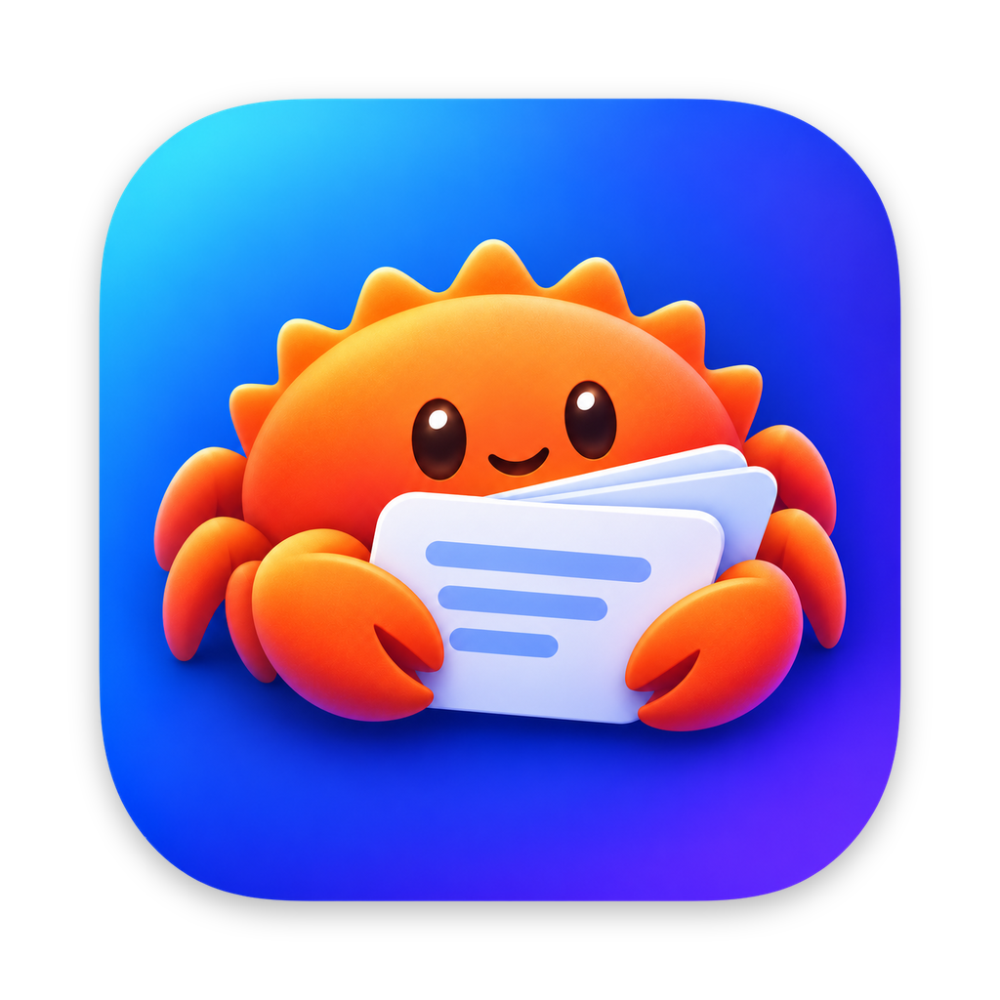

<div align="center">



# Runki

[](https://github.com/fhello23/runki/actions/workflows/ci.yml)
[](https://github.com/fhello23/runki/releases/latest)

</div>

A minimal Anki deck viewer written in Rust. No spaced repetition, no
grading, no limits: open a deck and spacebar through it for as long as
you want. The only extra is a "study later" list.

## Install

Download the latest version from the
[Releases page](https://github.com/fhello23/runki/releases/latest).
No Rust needed.

### macOS (Apple Silicon and Intel, macOS 11 or later)

1. Download `Runki-<version>-macos.zip` and unzip it.
2. Drag `Runki.app` into **Applications**.
3. Open it. The first time, macOS says it cannot check Runki for
   malware, because the app is not notarized by Apple (that needs a
   paid developer account). Click **Done**, then go to **System
   Settings → Privacy & Security**, scroll down, and click **Open
   Anyway** next to Runki. You only need to do this once per version.

   Or, from Terminal:

   ```sh
   xattr -dr com.apple.quarantine /Applications/Runki.app
   ```

To open a deck straight away from Terminal:

```sh
/Applications/Runki.app/Contents/MacOS/runki path/to/deck.apkg
```

### Linux (x86_64)

```sh
tar -xzf runki-<version>-linux-x86_64.tar.gz
cd runki-<version>-linux-x86_64
./runki                        # opens the library
./runki path/to/deck.apkg
./runki --tui                  # use the terminal interface
```

To run `runki` from any folder, move it onto your `PATH`, e.g.
`sudo mv runki /usr/local/bin/`.

### From source

With [Rust](https://rustup.rs) installed:

```sh
cargo run --release            # opens the library
cargo run --release -- path/to/deck.apkg
cargo run --release -- sample-deck.tsv
cargo run --release -- --tui   # opens the terminal library
```

Or install it as a `runki` command (in `~/.cargo/bin`), either from a
checkout or straight from a release tag:

```sh
cargo install --path . --locked
cargo install --git https://github.com/fhello23/runki --tag v0.3.5 --locked
```

## Terminal interface

The same binary includes a full terminal interface for local terminals,
SSH and tmux:

```sh
runki --tui
runki --tui path/to/deck.apkg
runki --tui --library ~/Decks
```

On macOS, the app bundle's executable supports the same options:

```sh
/Applications/Runki.app/Contents/MacOS/runki --tui
```

For a machine without a desktop, build or install without GUI dependencies:

```sh
cargo run --release --no-default-features -- --tui
cargo install --path . --locked --no-default-features
```

That build opens the TUI by default; a normal build still opens the desktop
app by default. `--library DIR` accepts an existing folder in either mode.
Inside the TUI, `c` also lets you create a new library folder. Type or paste
paths with spaces directly, use `~/` for your home folder, `Backspace` to
edit, and `Ctrl+u` to clear the input. `Esc` cancels a dialog.

| Key | Terminal action |
| --- | --- |
| `↑` / `↓` or `j` / `k`, `Enter` | Select and open a library deck |
| `a`, `c`, `r` in the library | Copy a deck in, choose/create a folder, refresh |
| `o` | Open any deck by path |
| `Space` / `Enter` while studying | Reveal answer, then advance (wraps) |
| `l` | Toggle study later |
| `1`, `2`, `3` | Show all, unseen, study-later cards |
| `d`, `s`, `r` while studying | Deck order, shuffled order, reshuffle |
| `R` | Reset seen progress, with confirmation; keeps study-later flags |
| `↑` / `↓` or `j` / `k`, `PageUp` / `PageDown`, `Home` / `End` | Scroll long cards; navigate library rows |
| `b` | Save and return to the library |
| `t` | Toggle light/dark terminal colours (remembered) |
| `w` | Toggle the LAN web interface |
| `?`, `e` | Scrollable help, full error/status message |
| `q` / `Ctrl+c` | Save and quit |

All deck formats, filters, shuffle, resume, progress merging and cloud
placeholder handling work as in the desktop app. Card text wraps to the
terminal width. Help and messages scroll with arrow keys or PageUp/PageDown.
An interactive terminal of at least 32 columns × 10 rows is needed;
80 × 24 or larger is more comfortable. Redirected input/output is rejected.

Progress saves every two seconds and before leaving a deck. If saving
fails, the deck stays open so you can retry or explicitly discard the
unsaved changes. Unreadable progress files remain untouched and are
labelled read-only for that session.

The two interfaces share their library folder and last-opened deck in a
per-machine `runki/config.json` inside the OS config directory:
`~/Library/Application Support` on macOS, `$XDG_CONFIG_HOME` (or
`~/.config`) on Linux, and `%APPDATA%` on Windows. Existing desktop
settings import automatically without altering the old settings file.
Deck progress stays in the same library `.runki/` folder or sidecar
described below, so switching interfaces resumes the same session.

## Web interface

Study from a phone or another browser on the same network. Choose a library
folder in Runki, then open **Web: Off** / **Web: On** in either desktop
screen's top bar and enable **Web server on**. The same configuration pane
shows the LAN address, **Copy URL**, a localhost address, and an editable
port. In the TUI, press `w` in the library or study screen. Open the displayed
`http://…:8765/` URL on your phone. Keep Runki running; turning Web off or
quitting stops the server.

On macOS, the **Runki** app menu also has a checked **Web Server** toggle.
The address item below it copies the LAN URL when clicked; when the server
is off it is disabled and labelled **Web Server Off**. These menu items
follow the in-app controls and current port.

**Anyone on this network can study and change progress.** There is no
login, PIN or encryption. Use Web only on a trusted network; do not forward
its port to the internet. macOS may ask whether Runki can accept incoming
network connections; allow it to reach Runki from your phone.

Web is off on first launch. The toggle choice and the port in the shared
config (`web_on`, `web_port`, default `8765`) are remembered. You can override
them for one run:

```sh
runki --web --library ~/Decks
runki --tui --web --web-port 9000
runki --no-web
```

`--web`, `--no-web` and `--web-port` do not change the remembered settings.
Using either desktop toggle or TUI `w` remembers its new on/off choice.
A CLI port override still lasts only for that run unless you deliberately
edit the port in the desktop Web pane and click **Apply**. Apply accepts only
digits from `1` to `65535` and remembers the new port for both interfaces,
including the TUI on its next launch.

When Web is on, Apply restarts it on the new port; reconnect using the new
address. If the new port is busy, Runki restores the old listener and shows
an error without changing the remembered port. If restoring the old listener
also fails, Web turns off. Starting Web on a busy port likewise leaves it
off with an error.

The browser can browse the library, reveal and advance cards, toggle study
later, change order and filters, reshuffle, and reset seen progress. Decks
must be downloaded and inside the chosen library; a deck opened separately
by path is not offered on the web. Add decks and choose folders in Runki.

Browser changes save after each action to the same `.runki/` progress files
as the desktop and TUI, with the existing merge-on-save behavior. The web
interface has its own study session (shared by browsers connected to that
Runki instance); it does not mirror the desktop's current card. Reopen a
deck to pick up another session's position and preferences. Card text is
plain text, with no image or audio serving.

## Version

Runki follows [Semantic Versioning](https://semver.org/). The version
is shown on the library and start screens and in **Runki → About
Runki** on macOS, and printed by:

```sh
runki --version                # runki 0.3.5
runki --help
```

What changed in each version is in [CHANGELOG.md](CHANGELOG.md).

## Library

Runki opens on a library screen: the decks in one folder, each with
its card count, `seen / total` progress, study-later count, and when
you last opened it (most recent first). On first launch you pick the
folder (the picker can create a new one, e.g. `Runki` in iCloud
Drive). Because decks and progress both live
in the folder, putting it in Dropbox or iCloud Drive syncs everything
between Macs; any local folder works too. The folder can be changed
later with **Change folder…**, and the choice is remembered per Mac.

- **Add deck…** (or dropping files onto the library screen) *copies*
  a deck into the library — never overwriting: a name clash becomes
  `name (2).apkg`, `name (3).apkg`, … Any progress the source deck
  already has is carried over to the copy.
- Clicking a deck opens it; **Library** in the study top bar goes
  back. **Refresh** re-reads the folder (e.g. after a sync).
- A deck that fails to parse (say, a stray notes `.txt`) stays listed
  with its error instead of failing the whole list.
- Decks can still be opened without a library — from the command
  line, **Open deck…**, or by dropping a file on the study screen —
  and keep working exactly as before.

You can also drag a deck file onto the study window to open it.

## Keys

| Key / button | Action |
| --- | --- |
| `Space` or click the card | Show the answer; press again for the next card (wraps around at the end) |
| `L` | Toggle the current card in the study-later list |
| **Library** | Save and go back to the library screen |
| **Theme icon** (top right) | Cycle match system → light → dark; remembered between launches |
| **Order:** `Deck order` / `Shuffled` | Show cards as they are in the deck, or in a shuffled order |
| **Reshuffle** (shuffled only) | Pick a new shuffle; the card on screen stays |
| **Show:** `All` / `Unseen` / `Later (n)` | Show every card, only cards you have not seen yet, or only flagged cards |

Revealing a card's answer marks it seen. In `Unseen`, the card stays
on screen until you move on. When every card has been seen, `Unseen`
offers **Reset progress** (also available any time via **Reset…** next
to the seen count, with a confirmation): seen marks are
cleared, study-later flags are kept. Below the card, a thin progress
bar shows its place in the shown list, alongside the deck's seen count
and **Reset…** control.

## Deck formats

- `.apkg` — real Anki decks, including modern exports. The newest
  collection found is used (`collection.anki21b`, then
  `collection.anki21`, then `collection.anki2`); the zstd-compressed
  `.anki21b` format from Anki 2.1.50+ is supported, so there is no need
  to re-export with "Support older Anki versions".
  A note's first field is the front; the remaining fields form the back.
- `.csv` / `.tsv` / `.txt` — one card per row: `front<separator>back`.
  Extra columns are appended to the back. A `front,back` header row is
  skipped.

## Progress

Study-later flags, which cards you have seen (a card becomes seen
when its answer is revealed), and where you left off — the current
card, order, filter, and shuffle — are saved with the deck, so they
survive restarts and sync with it:

- A deck in the library keeps its progress in the library's `.runki/`
  folder (`<library>/.runki/<deck>.json`), however it was opened.
- A deck outside the library keeps its progress in a
  `<deck>.runki.json` sidecar next to the deck file.

Reopening a deck resumes at the remembered card.
Delete that file to clear a deck's progress. A legacy
`<deck>.later.json` from older versions is imported once into the new
file and left in place. Editing a CSV row or renaming a deck file
loses that card's / deck's progress, because progress is keyed by
card id and deck file name.

## Syncing between Macs

Put the library folder in Dropbox or iCloud Drive and both the
decks and the progress in its `.runki/` folder come along. Syncing
is designed to be safe:

- Study-later flags and seen marks merge per card when progress is
  saved, so two Macs do not lose each other's flags or seen marks.
  If the sync service left a conflict copy of a progress file in
  `.runki/` (e.g. `French.apkg (… conflicted copy …).json`),
  Runki merges it into that deck's progress and removes the copy.
- A deck that is not downloaded on this Mac yet (online-only)
  shows greyed as "Not downloaded" with a **Show in Finder**
  button. Runki never reads it — opening it would block on the
  download — so download it in Finder first, then **Refresh**.
- Two Macs studying the same deck at the same moment is fine, but
  each keeps its own current card until the deck is reopened.

## Limitations (by design, it is a plain viewer)

- Card HTML is shown as plain text; images appear as `[image]` and
  audio is ignored.
- Cloze deletions are shown with the answer revealed.
- Reversed cards generated from the same note are shown once.
- Cards loop forever in the chosen order. "Seen" is only a checkmark:
  no scheduling, grading, or stats beyond the seen count.
- On macOS, decks are opened from inside Runki (or dropped onto its
  window), not by double-clicking them in Finder or dropping them on
  the Dock icon.

## Releasing

The version lives only in `Cargo.toml`; everything else reads it
from there. While working, each PR that changes what users see adds a
line under **Unreleased** in [CHANGELOG.md](CHANGELOG.md).

To publish a release:

1. In a PR, bump `version` in `Cargo.toml` (patch for fixes, minor for
   features, while Runki is `0.x`), run `cargo check` so `Cargo.lock`
   follows, and rename **Unreleased** in the changelog to
   `[X.Y.Z] - <date>` (leave an empty **Unreleased** above it and
   update the compare links at the bottom).
2. Merge it, then tag that commit on `main` and push the tag:

   ```sh
   git checkout main && git pull
   git tag vX.Y.Z
   git push origin vX.Y.Z
   ```

3. The [Release workflow](.github/workflows/release.yml) checks that
   the tag matches `Cargo.toml`, builds `Runki.app` (one universal
   build for Apple Silicon and Intel, ad-hoc signed) and a Linux
   binary, and publishes a GitHub Release with that version's
   changelog notes. If the tag and `Cargo.toml` disagree, or the
   changelog has no notes for the version, nothing is published:
   delete the tag (`git push --delete origin vX.Y.Z`), fix it, and tag
   again.

Pull requests that change the release workflow or
`scripts/bundle-macos.sh` run the builds too (without publishing).
To build the macOS app locally:

```sh
cargo build --release
scripts/bundle-macos.sh target/release/runki target/dist   # → target/dist/Runki.app
```
